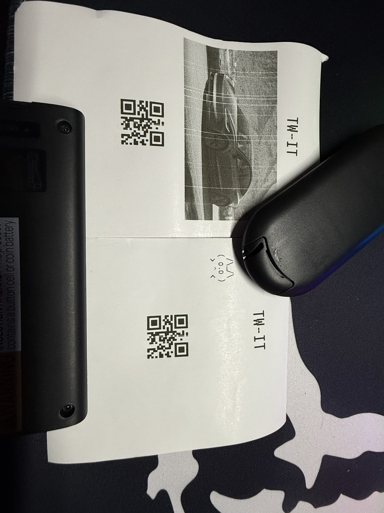
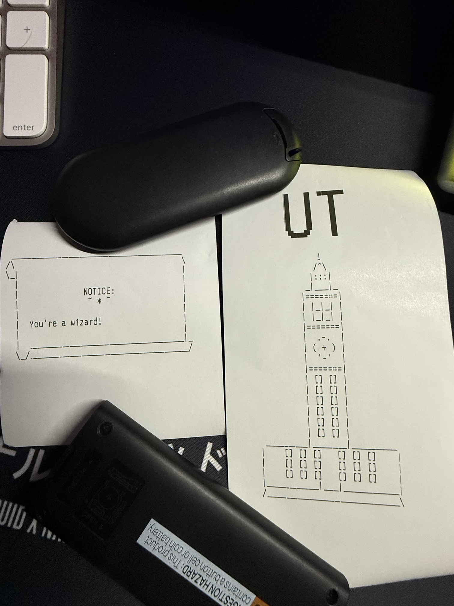

# tm-l90_thermal_printer_art

Print text, ASCII art, images and QR codes to an Epson TM-L90 thermal printer using Python and ESC/POS.

## Results

| `tm-l90 code.py` — header, ASCII art, image and QR | `scroll_print.py` and `tower_print.py` |
|:---:|:---:|
|  |  |

## Requirements

- Windows with the EPSON Advanced Printer Driver (APD) for the TM-L90 installed, using a USB port
- Python 3.14 (3.15 isn't supported yet by the PyYAML dependency)

```powershell
py -3.14 -m pip install "python-escpos[all]" pillow
```

## Scripts

### `tm-l90 code.py` — text, art, images, QR

```powershell
py -3.14 "tm-l90 code.py" --list                  # show installed printers
py -3.14 "tm-l90 code.py"                         # demo print
py -3.14 "tm-l90 code.py" --text "Hello world"    # custom text
py -3.14 "tm-l90 code.py" --art art.txt           # ASCII art from a file
py -3.14 "tm-l90 code.py" --image logo.jpg        # image (auto-resized and dithered)
```

Other options: `--printer "Name"` to choose a printer, `--no-qr` to skip the QR code.

### `scroll_print.py` — parchment scroll

Wraps your message inside an ASCII scroll that grows with your text.

```powershell
py -3.14 scroll_print.py                                    # demo proclamation
py -3.14 scroll_print.py "Your message" --title "Notice"
py -3.14 scroll_print.py "Paragraph one.\nParagraph two."   # \n = new paragraph
py -3.14 scroll_print.py "Your message" --preview           # show in terminal, no printing
```

```
 ____________________________________________
/\                                           \
\_|                                          |
  |                  NOTICE                  |
  |                  ~ * ~                   |
  |                                          |
  |  Your message.                           |
  |  ________________________________________|_
  \_/_________________________________________/
```

### `tower_print.py` — UT Tower

A giant "UT" in the printer's largest built-in font, with an ASCII UT Tower underneath.

```powershell
py -3.14 tower_print.py                                 # giant UT + tower
py -3.14 tower_print.py --text "YOUR TEXT" --size 3     # custom headline, size 1-8
py -3.14 tower_print.py --caption "Austin, Texas"       # small line under the tower
py -3.14 tower_print.py --preview                       # show in terminal, no printing
```

```
                   U T          (printed at 8x size)

                    !
                   /^\
                  |:::|
                 _|___|_
                |=======|
                | |_|_| |
                |  .-.  |
                | ( + ) |
                |  '-'  |
                | [] [] |
       _________|_______|_________
      |    [] [] []   [] [] []    |
      |___________|___|___________|
      /___________________________\
```

## Notes

- Paper width is set by `PAPER_WIDTH_DOTS` at the top of each script: `576` for 80 mm paper, `420` for 58 mm.
- ASCII art fits up to 48 characters per line on 80 mm paper.
